

# 🤖 Transformer Architecture & NLP Practical

## From Attention Mechanisms to a Mini NLP Application

**A task-wise practical exploration of Transformer theory, attention, pretrained language models, text generation, evaluation, and an integrated NLP toolkit.**

---

## 📌 Project Overview

This project explores the core ideas behind the Transformer architecture and applies pretrained Transformer models to real Natural Language Processing (NLP) tasks. It combines theory, visualizations, coding experiments, performance measurements, and a small application.

The notebook progresses from tokenization and attention mechanisms to encoder/decoder architectures, text generation, sentiment analysis, summarization, and French translation.

### Project at a Glance

| Item | Details |
|---|---|
| Project type | Deep Learning / Natural Language Processing |
| Main environment | Jupyter Notebook |
| Core libraries | Transformers, PyTorch, NumPy, pandas, Matplotlib, scikit-learn |
| Pretrained models | DistilBERT, GPT-2, T5-small |
| Main deliverables | Notebook, output previews, `requirements.txt`, this README, HTML export |

## 🎯 Objectives

- Understand the history and basic architecture of Transformers.
- Explore tokenization, model pipelines, and pretrained language models.
- Implement and inspect scaled dot-product attention and multi-head attention.
- Understand positional encoding, layer normalization, encoder blocks, and causal masking.
- Explore cross-attention, decoder behavior, and text-generation strategies.
- Evaluate pretrained models and measure sequence-length and KV-cache performance.
- Build a mini text toolkit for sentiment analysis, summarization, and French translation.
- Record limitations, experimental observations, and lessons learned.

---

## 🧰 Technologies Used

- **Python** — implementation and experiment workflow
- **Jupyter Notebook** — step-by-step coding, explanations, and outputs
- **Hugging Face Transformers** — pretrained tokenizers and models
- **PyTorch** — model execution and inference
- **NumPy and pandas** — numerical operations and result tables
- **Matplotlib / Seaborn** — plots and attention visualizations
- **scikit-learn** — evaluation metrics and classification reports

### Pretrained Models

| Model | Family | Use in this project |
|---|---|---|
| `distilbert-base-uncased` | Encoder-only | Masked-token prediction and encoder experiments |
| `distilbert/distilbert-base-uncased-finetuned-sst-2-english` | Encoder-only | Sentiment classification |
| `gpt2` | Decoder-only | Autoregressive text generation and decoding experiments |
| `t5-small` | Encoder-decoder | Summarization, translation, and cross-attention experiments |

> **Note:** Model names and library versions should match the notebook environment used for the final run. The exact installed package versions are recorded in `requirements.txt`.

---

# 📚 Task-wise Work

# Task 1 — Introduction, History, Pipelines & Tokenizer

## What I did
- Reviewed the motivation and development of Transformer models.
- Used Hugging Face pipelines to explore pretrained NLP functionality.
- Examined tokenization and how text is converted into model-readable token IDs.
- Explored DistilBERT masked-token prediction using example sentences.
- Compared possible predictions and confidence scores.

## Key learning
Tokenizers split text into tokens and map them to IDs. Pretrained pipelines provide a convenient interface for running common NLP tasks without implementing an entire model from scratch.

---

# Task 2 — Self-Attention & Scaled Dot-Product Attention

## What I did
- Explored queries, keys, and values (Q, K, V).
- Examined the scaled dot-product attention formula.
- Calculated attention scores and normalized attention weights.
- Visualized how tokens assign attention to other tokens.
- Reviewed how attention weights influence the combination of value vectors.

## Key learning
Self-attention allows a token to use information from other tokens in the sequence. The attention scores indicate how strongly tokens relate within a particular layer and head; they should not automatically be interpreted as a complete explanation of model reasoning.

---

# Task 3 — Multi-Head Attention, Positional Encoding & Layer Normalization

## What I did
- Explored why Transformers use multiple attention heads.
- Compared attention patterns across heads.
- Examined positional encoding and its role in representing token positions.
- Reviewed layer normalization and its role in stabilizing model computations.
- Created visualizations to inspect attention and positional information.

## Key learning
Multiple attention heads can learn different token relationships. Since attention alone does not inherently encode sequence order, positional information is also needed. Layer normalization helps stabilize activations during model processing.

---

# Task 4 — Transformer Encoder Architecture & Masked Self-Attention

## What I did
- Examined the main components of a Transformer encoder block.
- Reviewed self-attention, feed-forward layers, residual connections, and layer normalization.
- Explored masked self-attention and the purpose of attention masks.
- Inspected attention patterns and the effect of masking where applicable.

## Key learning
A Transformer encoder block combines attention and feed-forward processing with residual connections and normalization. Attention masks restrict which positions a token can attend to. A causal mask is especially important for autoregressive decoder models because it prevents access to future tokens.

---

# Task 5 — Cross-Attention, Decoder Architecture & Inference

## What I did
- Explored cross-attention and how a decoder can use encoder outputs.
- Inspected T5-small cross-attention patterns.
- Examined GPT-2 autoregressive generation.
- Compared decoding approaches such as greedy decoding, beam search, temperature sampling, and top-k/top-p sampling.
- Benchmarked text generation with and without KV-cache.
- Reviewed the roles of encoder-only, decoder-only, and encoder-decoder model families.

## Key learning
Decoder-only models generate text autoregressively, while encoder-decoder models can condition generation on an encoded input. Decoding strategies affect the diversity and determinism of generated text. KV-cache can reduce repeated computation during autoregressive generation, at the cost of additional memory.

---

# Task 6 — Mini Application, Evaluation & Disadvantages

## What I did
- Evaluated DistilBERT sentiment predictions on movie reviews.
- Compared sentiment results at different truncation lengths.
- Measured inference time at sequence lengths of 32, 64, 128, 256, and 512 tokens.
- Generated GPT-2 continuations and reviewed example outputs for factual accuracy.
- Built `text_toolkit(text)` to return sentiment, sentiment score, a summary, and a French translation.
- Tested the toolkit on a movie review, a news-style paragraph, and an original passage.
- Added handling for empty input and very long text.
- Wrote a final reflection on Transformer behavior, performance, and practical limitations.

## Measured observations

### Sequence-length inference benchmark

| Sequence Length | Average Inference Time |
|---:|---:|
| 32 | 25.94455 ms |
| 64 | 48.77684 ms |
| 128 | 88.08846 ms |
| 256 | 140.64372 ms |
| 512 | 277.76129 ms |

These measurements are from the notebook run and may vary with hardware, system load, and software versions.

### KV-cache benchmark

| Setting | Average Generation Time |
|---|---:|
| With KV-cache | 3.1741 seconds |
| Without KV-cache | 7.5771 seconds |
| Measured speedup | **2.39×** |

The measured speedup is specific to this experiment and configuration; it is not a guarantee for every model or device.

## Key learning
Transformer models can support useful NLP workflows, but longer inputs can increase inference cost and generated text can contain factual errors. Model outputs need to be evaluated, and factual claims should be checked against reliable sources.

---

# 🔍 Key Findings

1. **Tokenization:** Text must be converted into tokens and token IDs before a Transformer can process it.
2. **Attention:** Self-attention helps tokens use information from other tokens; multiple heads can learn different relationships.
3. **Positional information:** Position information helps the model distinguish token order.
4. **Model families:** Encoder-only, decoder-only, and encoder-decoder models serve different NLP purposes.
5. **Generation:** Decoding choices influence the generated output and its diversity.
6. **Inference performance:** In this notebook run, average inference time increased from **25.94455 ms at sequence length 32** to **277.76129 ms at length 512**.
7. **KV-cache:** The measured generation speedup was approximately **2.39×** with caching compared with generation without caching.
8. **Reliability:** Fluent generated text is not necessarily factually correct; generated claims require verification.

---

# ⚠️ Limitations

- Pretrained model outputs may be incorrect, incomplete, or biased.
- Summarization and translation quality can vary with the input.
- Truncation can remove information needed for sentiment classification or summarization.
- Inference measurements depend on hardware, system load, and implementation details.
- KV-cache improves generation efficiency in this benchmark but uses additional memory.
- The preview gallery depends on screenshots being added to the repository.

---

# 🚀 Future Improvements

- Test the mini toolkit on a larger and more diverse set of texts.
- Compare additional sentiment-analysis and summarization models.
- Evaluate summaries and translations with appropriate task-specific metrics and human review.
- Repeat performance benchmarks and report hardware and software details.
- Add a simple user interface for entering text and viewing all outputs.
- Validate factual claims using reliable external sources.

---

# 🧠 Overall Final Conclusion

This practical notebook connected Transformer theory with hands-on NLP experiments. Across six tasks, I explored tokenization, self-attention, multi-head attention, positional encoding, encoder and decoder components, cross-attention, text generation, and model evaluation. I also used DistilBERT, GPT-2, and T5-small to investigate sentiment classification, generation, summarization, and French translation.

The experiments showed that longer sequences can increase inference time and that KV-cache can improve generation efficiency. The mini text toolkit demonstrated how pretrained models can be combined into a single application. At the same time, the project highlighted the need to handle long inputs carefully, evaluate outputs, and verify factual claims.

Overall, this project strengthened my understanding of Transformer architecture, practical model usage, performance evaluation, and the limitations that must be considered when developing real-world NLP applications.

---

# 📖 Extended Project Documentation

This section provides a more detailed task-by-task guide, review notes, reproducibility guidance, and a practical checklist for readers who want to understand or rerun the notebook.

## 2. Task 1 — Detailed Review Guide

###  DistilBERT Parameter Distribution

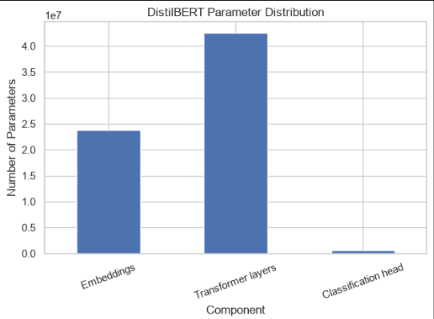

**Concept:**

This output examines how model parameters are distributed across the
components of DistilBERT. Parameters are the learned numerical values
that help a neural network represent language patterns and relationships.

**Conclusion:** The parameter distribution illustrates how a pretrained Transformer allocates learnable values across its model components.

## 3. Task 2 — Detailed Self-Attention Review

###  Scaled Dot-Product Attention Weights

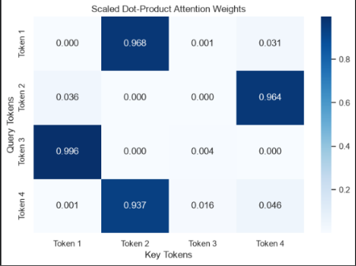

**Concept:**

Scaled dot-product attention calculates relationships between queries
and keys, scales the scores by the square root of the key dimension,
and applies softmax to obtain attention weights.

The scaling operation helps prevent excessively large dot-product
scores from making the softmax distribution too concentrated.

**Conclusion:** Scaled dot-product attention converts query-key similarity scores into normalized attention weights.

###  Scaling and Attention Entropy

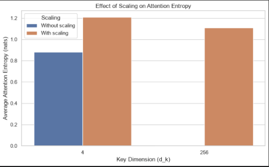

**Concept:**

Attention entropy measures how distributed or concentrated an attention
probability distribution is. Higher entropy generally indicates a more
spread-out distribution, while lower entropy indicates greater concentration.

**Conclusion:** The entropy plot demonstrates how score scaling changes the distribution of attention across tokens.

###  Luong Dot-Product Attention Weights

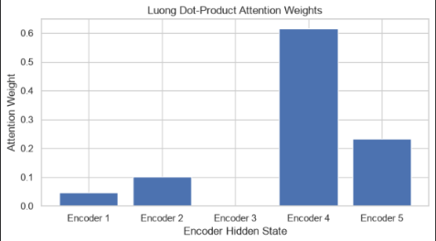

**Concept:**

Luong dot-product attention calculates similarity between decoder
hidden states and encoder hidden states using a dot product. The resulting
scores indicate which encoder positions are most relevant to a decoder step.

**Conclusion:** Luong attention uses hidden-state similarity to assign different importance to input positions.

###  Manually Calculated vs Actual Attention

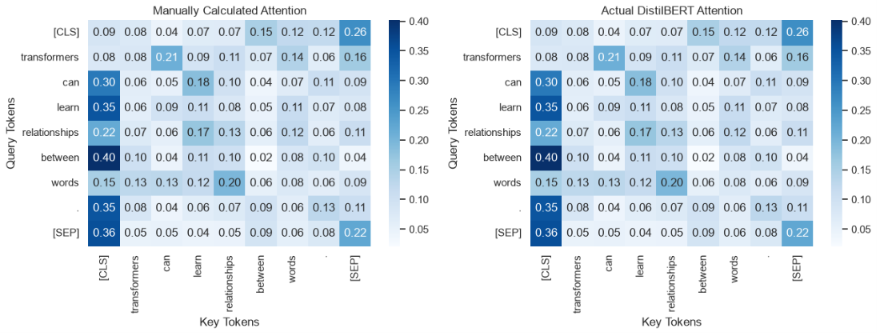

**Concept:**

This comparison checks an attention calculation performed manually
against the corresponding implementation. The standard scaled attention
formula is:

Attention(Q, K, V) = softmax(QKᵀ / √dₖ)V

Matching results help verify the mathematical implementation.

**Conclusion:** Agreement between the manual calculation and the implementation supports the correctness of the attention calculation.

## 4. Task 3 — Multi-Head Attention, Position and Normalization

### 3.1 Multi-head attention

- Multi-head attention uses multiple attention operations in parallel.
- Each head works with learned projections of the input representations.
- Heads can capture different kinds of token relationships.
- The head outputs are combined and projected to produce the final output.
- The number of heads must be compatible with the hidden representation dimensions.
- More heads do not automatically guarantee better performance.

## 5. Task 4 — Encoder Blocks and Attention Masks

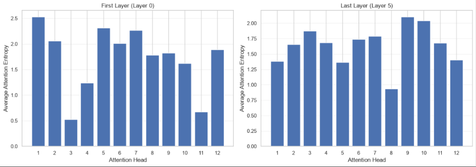

**Concept:**

This comparison examines average attention patterns from an early
Transformer layer and a later layer. Different layers may focus on
different token relationships as contextual representations develop.

**Conclusion:** Comparing early and late layers helps illustrate how attention patterns can vary throughout a Transformer.

---

## Task 2 — Positional Encoding and Positional Embeddings

###  Sinusoidal Positional Encoding

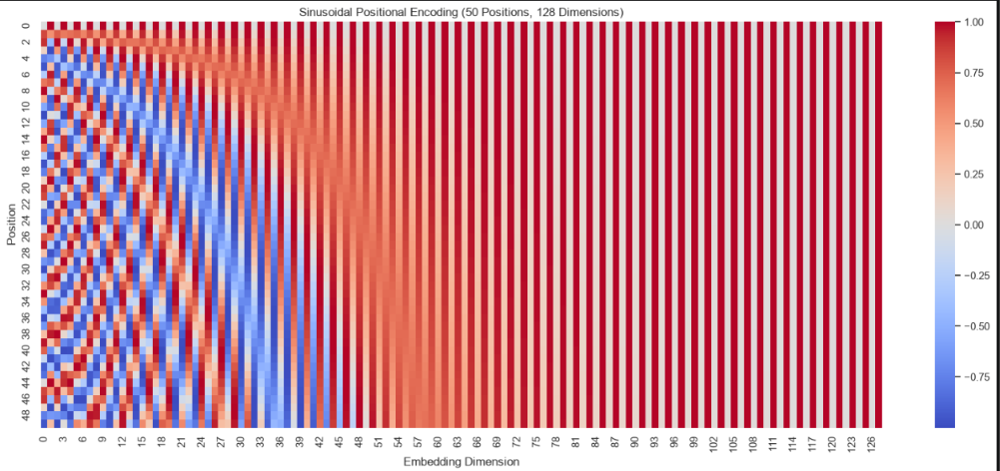

**Concept:**

Sinusoidal positional encoding adds position-dependent values to token
representations. Sine and cosine functions at different frequencies
provide positional information to the Transformer.

Unlike learned positional embeddings, these encodings are calculated
using fixed mathematical functions.

**Conclusion:** Sinusoidal positional encoding provides position information through deterministic sine and cosine patterns.

###  DistilBERT Learned Positional Embeddings

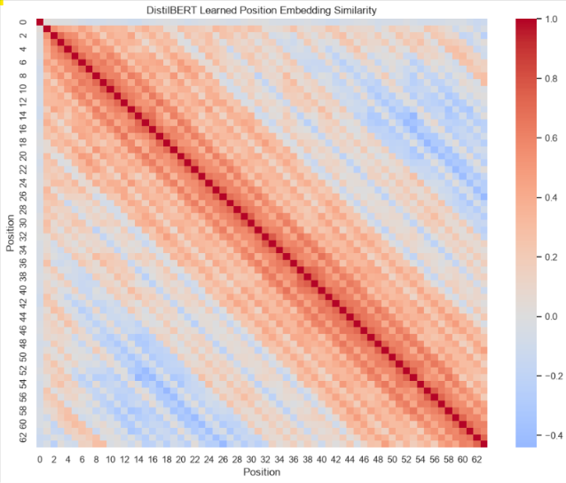

**Concept:**

DistilBERT uses learned positional embeddings to represent token positions.
These embeddings are parameters learned during model training rather
than fixed sinusoidal values.

**Conclusion:** Learned positional embeddings allow DistilBERT to represent token positions using trainable vectors.

## 6. Task 5 — Decoder, Cross-Attention and Text Generation

###  DistilBERT Trainable Parameter Distribution

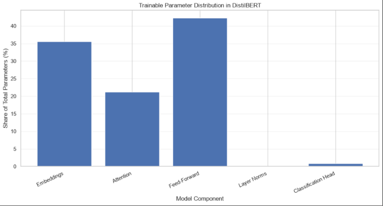

**Concept:**

This output examines the distribution of trainable parameters in DistilBERT.
It helps distinguish parameters that can be updated during training from
parameters that have been frozen.

**Conclusion:** Trainable-parameter analysis helps identify which parts of a model can be updated during fine-tuning.

###  DistilBERT Trainable Parameter Distribution

**Concept:**

This output examines the distribution of trainable parameters in DistilBERT.
It helps distinguish parameters that can be updated during training from
parameters that have been frozen.

**Conclusion:** Trainable-parameter analysis helps identify which parts of a model can be updated during fine-tuning.

---

## Task 3 — Attention Maps and Transformer Masks

###  DistilBERT Last-Layer Attention Heatmap

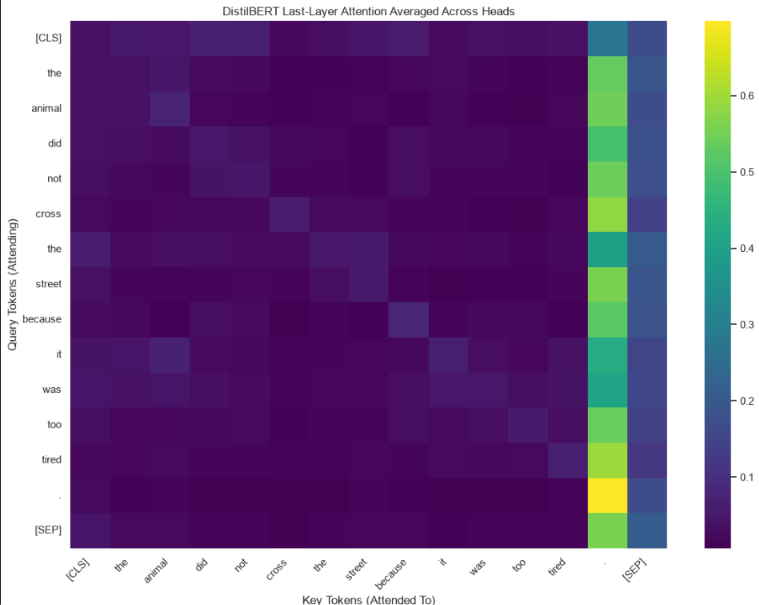

**Concept:**

An attention heatmap visualizes attention weights between token positions
in the last layer of DistilBERT. Each cell represents the attention
weight assigned by one token position to another.

**Conclusion:** The heatmap provides a visual representation of token-to-token attention in the final DistilBERT layer.

###  Causal Self-Attention for Six Tokens

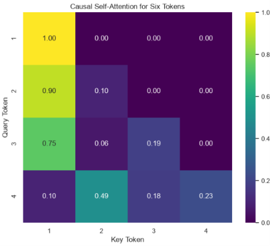

**Concept:**

Causal self-attention prevents a decoder token from attending to future
tokens. A causal mask blocks future positions so that each token can
use only the permitted earlier and current positions.

**Conclusion:** Causal masking enforces the left-to-right information flow required for autoregressive text generation.

###  GPT-2 Last-Layer Attention

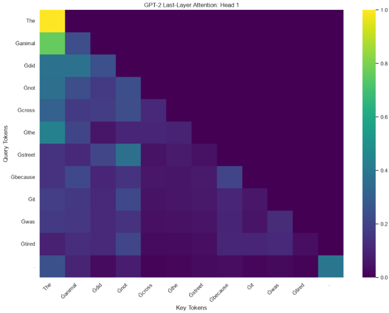

**Concept:**

GPT-2 is an autoregressive Transformer that generates text one token at
a time. Its attention visualization shows how token positions distribute
attention over the available context under causal masking.

**Conclusion:** GPT-2 attention illustrates how a decoder-only Transformer processes preceding context during text generation.

###  DistilBERT Attention with Padding Mask

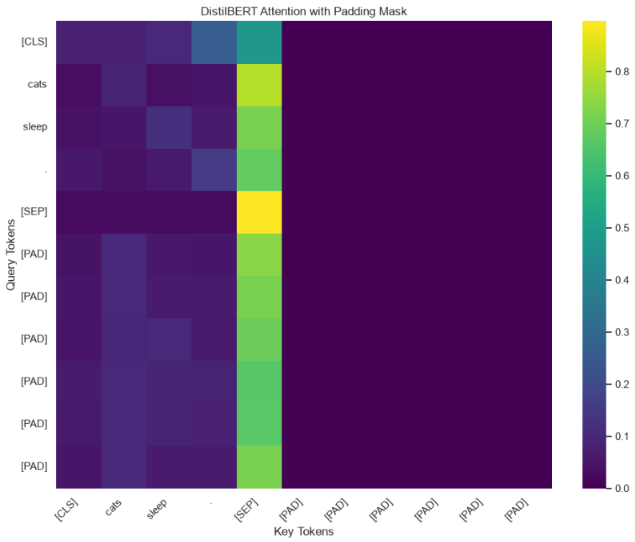

**Concept:**

Padding is used to make sequences in a batch compatible in length.
An attention mask identifies valid tokens and padding positions so that
padding does not contribute as ordinary input content.

**Conclusion:** The padding mask helps the model distinguish meaningful input tokens from added padding positions.

## 7. Task 6 — Evaluation and Mini Application

###  Cache vs No-Cache Benchmark

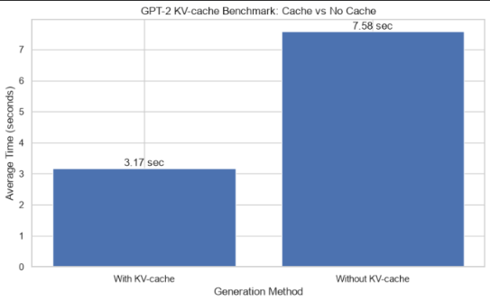

**Concept:**

During autoregressive generation, a key-value (KV) cache stores key
and value representations from previous tokens. Reusing cached
representations can avoid recomputing them at every generation step.

The measured speedup is calculated as:

Speedup = Average time without cache / Average time with cache

**Conclusion:** The benchmark compares generation time with and without KV caching and shows the performance difference measured in this environment.

### 6.1 Sentiment analysis

- DistilBERT is an encoder-only Transformer model family.
- The selected checkpoint is fine-tuned for sentiment classification.
- The model returns a predicted label and a score.
- The score is not a guarantee that the prediction is correct.
- Reviews may contain sarcasm, mixed opinions, or ambiguous wording.
- Accuracy alone can hide class-specific errors.
- Use representative examples where possible.
- Keep the exact model identifier in the notebook.

###  DistilBERT Sentiment Confusion Matrix

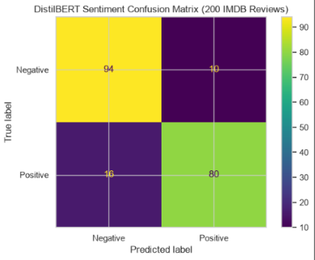

**Concept:**

A confusion matrix compares actual sentiment labels with model predictions.
It contains true positives, true negatives, false positives, and false
negatives, depending on which class is treated as positive.

This matrix helps identify correct predictions and the two types of
classification errors.

**Conclusion:** The confusion matrix reveals how accurately DistilBERT distinguishes positive and negative reviews on the evaluated dataset.

###  Accuracy vs Truncation Length

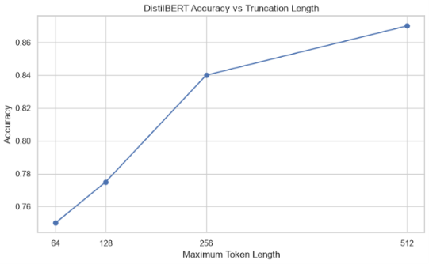

**Concept:**

Transformer tokenizers often truncate inputs to a selected maximum
sequence length. Shorter limits reduce the number of processed tokens
but may remove information needed for accurate sentiment classification.

This experiment compares sentiment accuracy across different
truncation lengths.

**Conclusion:** The plot shows how the selected maximum input length affects sentiment accuracy in the evaluated sample.

###  DistilBERT Forward-Pass Time vs Sequence Length

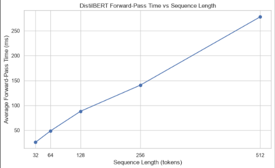

**Concept:**

This experiment measures the time taken by DistilBERT to process
inputs of different sequence lengths. Self-attention has a pairwise
token interaction component whose computational and memory requirements
typically grow quadratically with sequence length.

Actual measured runtime can also depend on CPU or GPU hardware, batching,
model overhead, and implementation details.

**Conclusion:** The benchmark demonstrates how input sequence length affects the measured DistilBERT forward-pass time on the tested hardware.

---

###  Interpretation

- Generation with cache was faster in this recorded experiment.
- The speedup is the no-cache average divided by the cache average.
- KV-cache reduces repeated computation for previous tokens.
- Cache storage uses additional memory.
- Different prompts, sequence lengths, devices, and generation settings can change the result.
- The measured speedup should not be treated as a guarantee for every system.

## 8. Glossary

- **Attention:** A mechanism that combines information from different sequence positions.
- **Causal mask:** A mask that prevents access to future positions.
- **Cross-attention:** Attention that uses representations from another sequence or component.
- **Decoder:** A component that generates or transforms output representations.
- **Encoder:** A component that creates contextual input representations.
- **Embedding:** A learned vector representation of a token.
- **Fine-tuning:** Further training of a pretrained model for a particular task.
- **Inference:** Running a trained model to obtain predictions or generated text.
- **KV-cache:** Stored key and value tensors reused during autoregressive generation.
- **Layer normalization:** Normalization across the feature dimension of a representation.
- **Logits:** Unnormalized scores produced before a probability transformation.
- **Multi-head attention:** Multiple attention heads whose outputs are combined.
- **NLP:** Natural Language Processing.
- **Positional encoding:** Information representing token positions or sequence order.
- **Pretrained model:** A model whose parameters were learned before use in a downstream task.
- **Sampling:** Selecting a token probabilistically from a distribution.
- **Self-attention:** Attention where queries, keys, and values come from the same sequence.
- **Token:** A unit produced by a tokenizer.
- **Tokenizer:** A component that converts text into token sequences and IDs.
- **Truncation:** Removing tokens beyond a configured maximum length.
- **Temperature:** A sampling parameter controlling the sharpness of token probabilities.
- **Top-k:** Sampling restricted to the k highest-scoring eligible tokens.
- **Top-p:** Sampling restricted by a cumulative probability threshold.

# 📦 Requirements

The `requirements.txt` file should contain the actual package versions installed in the environment used to run the notebook. Main libraries include:

- `transformers`
- `torch`
- `datasets`
- `numpy`
- `pandas`
- `matplotlib`
- `scikit-learn`
- `sentencepiece`
- `jupyter`
- `ipykernel`

Do not guess package versions. Generate the file from the working environment and verify it before uploading.

---

##  Final Notes for Reviewers

This project demonstrates conceptual understanding and practical experimentation with Transformer models. The notebook contains the implementation and outputs, while the README summarizes the objectives, findings, limitations, and steps needed to reproduce the work.

The benchmark numbers describe one recorded run. Small differences may occur on another computer or with different package versions. The screenshot paths are naming conventions and should be checked against the actual uploaded images.

The reflection should describe the experiments that were actually run, not theoretical results that were never measured. The purpose of the practical is to understand how the models behave, evaluate their outputs, and explain the trade-offs involved in real NLP applications.

---

## 👤 Author

**Name:** Santosh Verma
**Project:** Transformer Architecture & NLP Practical  

---

**⭐ If you find this project useful, consider giving the repository a star.**

---

**End of Project Documentation**

